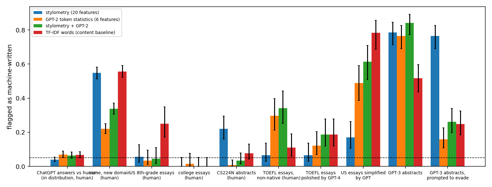

# Who does an AI-text detector accuse?

An audit of simple AI-text detectors on **real human and machine texts**: trained on ChatGPT-vs-human answers, then tested on writers,
domains and generators they never saw, and on text written to evade them. The question is not "how accurate is it" but **who gets
wrongly flagged**.

**Data (all real, none generated here).** [HC3](https://huggingface.co/datasets/Hello-SimpleAI/HC3): human and ChatGPT answers in five
domains (6,000 questions from four domains, split 70/15/15 for training, validation and test; the fifth domain, CS abstracts, is held out entirely). Liang et al. 2023
([repo](https://github.com/Weixin-Liang/ChatGPT-Detector-Bias)): TOEFL essays by non-native writers (91) and the same essays polished by
GPT-4, US 8th-grade essays (88) and a GPT-simplified version, college-application essays (70) and CS224N abstracts (145) with GPT-3
versions, including GPT-3 prompted to write in more literary language to evade detectors. Every text is cut to its first 160 words so length
cannot decide the label.

**Detectors.** 20 stylometric features (sentence-length burstiness, type-token ratio, transitions, punctuation, ...); six GPT-2 token
statistics (mean log-probability, its spread, entropy, share of top-1 tokens: the classic "perplexity" signals); both together; and a TF-IDF
baseline. Each threshold is fixed once so that 5% of human validation answers are flagged; everything else is measured at that threshold.



## Findings

| group (all human unless stated) | stylometry | GPT-2 statistics | both | TF-IDF |
|---|---:|---:|---:|---:|
| ChatGPT-vs-human test, human answers | 3.9% | 6.9% | 6.4% | 6.6% |
| same, **new domain** (CS abstracts), human | 54.8% | 22.0% | 33.8% | 55.7% |
| US 8th-grade essays | 5.7% | 3.4% | 4.5% | 25.0% |
| college essays | 0.0% | 1.4% | 0.0% | 0.0% |
| **TOEFL essays, non-native writers** | 6.6% | **29.7%** [21, 40] | **34.1%** [25, 44] | 11.0% |
| TOEFL essays polished by GPT-4 | 6.6% | 12.1% | 18.7% | 18.7% |
| GPT-3 abstracts | 78.6% | 76.6% | 84.1% | 51.7% |
| GPT-3 abstracts **prompted to evade** | 76.6% | 15.9% | 26.2% | 24.8% |

- **In distribution it looks perfect**: AUROC 0.98 to 0.999 on held-out ChatGPT answers, for every detector.
- **The perplexity-style detectors accuse non-native writers**: about 30% of TOEFL essays are flagged against 0% to 5% of native writers'
  (the same bias Liang et al. reported for commercial detectors, reproduced here with a small model). Non-native essays have lower
  perplexity, so they look machine-made: mean token log-probability -3.09 for them against -3.79 for native essays and -2.25 for ChatGPT.
- **Polishing makes it worse in the wrong direction**: the GPT-4-polished TOEFL essays are flagged *less* than the originals (12% to 19% against
  30% to 34%), and on the pair human original vs polished the combined detector scores AUROC 0.40, below chance.
- **Evasion works**: asking GPT-3 for literary language drops detection from 77% to 16% for the perplexity detector. The stylometric
  detector survives it (77%) but flags 22% of human CS224N abstracts (against 1% to 8% for the others).
- **Domain shift breaks the false-positive rate**: on a new domain the same threshold flags 22% to 56% of human text, not 5%.

So no single detector is safe to use as evidence against a person. A threshold set in distribution does not control who is accused elsewhere.
Limits: small non-native sample (91 essays; intervals are wide), 160-word excerpts, GPT-2 small as the language model, the evasion set is one
prompting strategy on one generator, and results say nothing about newer commercial detectors.

## Run

```bash
pip install -e .[dev]
python scripts/get_data.py              # HC3 (74 MB) and the essay sets, into data/
python -m aitext.study --data data --out results      # about an hour on CPU (GPT-2 features are cached)
python scripts/plot.py && pytest        # 5 tests
```

`course-notebooks/` holds the earlier course project (a six-class hierarchical classifier of human, polished, humanised and mixed texts on a
361,579-article dataset that is not included, 62.2% accuracy, macro F1 0.54, with Apriori-mined rules); its data is not available, so it is not
reproduced here.
